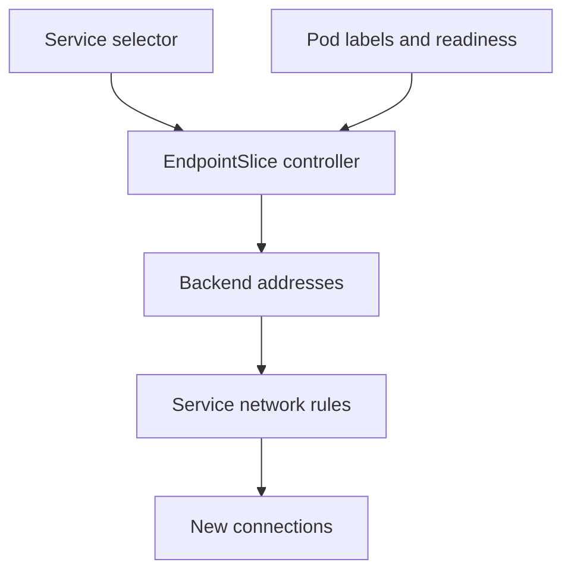

# Switching Service Traffic Between Two Versions

The `probe` application must move from version one to version two without replacing its public address. Keeping both versions running lets you test the replacement before changing traffic. The difficult part is proving that the replacement is ready and that the Service selects only the version you intended.

## Learning objectives

- Explain how a Service selector separates two application versions.
- Identify the components that update backend routing after a switch.
- Distinguish traffic reversal from restoration of application data.

## Before you start

Use a shell on your own machine with the module playground running. A Pod is Kubernetes's unit for running one or more containers together. The environment provides the `probe` Deployment, which maintains application Pods, and the `starfleet` namespace, which groups these objects.

Read-only commands below use kubectl, the Kubernetes command-line tool. Select the private kubeconfig: the file that identifies this environment's cluster and credentials. The commands do not change the application.

## Switching Service Traffic Between Two Versions

Blue-green deployment keeps two application versions available and changes which version receives normal traffic. A Kubernetes Service provides a stable access point and normally selects backend Pods through labels. In a basic blue-green design, changing that selector moves the Service's eligible backend set from one prepared version to the other.

## Build Two Distinct Backend Sets

Imagine `scout-blue` and `scout-green` Deployments. Both Pods carry `app: scout`, but their templates also carry different `version` labels. A Service selecting both `app: scout` and `version: blue` chooses only the blue set. A selector containing only `app: scout` can include both sets, which changes the design into shared routing rather than an isolated switch.

Deployment selectors and Service selectors serve different purposes. Each Deployment must own its intended Pods through a consistent selector and template relationship. The Service chooses which eligible Pods receive its traffic. Updating the Service does not change Deployment ownership, images or desired replica counts.

Pod readiness influences ordinary eligible endpoints. A green Pod existing in the cluster is not enough: it must reach a useful ready state and be able to serve its dependencies. A Service selector that switches to an empty or unready set can interrupt requests even while the previous blue application remains healthy.

## Examine The New Version Before Switching

A separate preview Service can select green Pods for isolated evaluation. That preview needs its own reachable access path; its existence alone does not expose the application publicly. The checks should cover response correctness, dependency compatibility and readiness, rather than merely seeing that a container process started.

Backend port mapping remains part of the contract. The Service's exposed `port` and backend `targetPort` have different roles. If the new image listens on another port but the Service still targets the old one, a correct selector change can still produce connection failures. Named backend ports require matching declarations in the selected Pods.

Capacity also matters. Keeping both versions ready consumes resources for both sets. If the green version cannot schedule because the cluster lacks capacity, a selector change cannot solve that shortage. Preparing the replacement set requires both application health and enough running backends to meet the traffic demand.

## What Happens During The Switch

A selector update changes the declared selection. Controllers and network implementations then reconcile the backend and routing state. This is not a universal atomic transaction across every client, node and connection. Different observers can see the transition at different times, and an already established connection may continue using its existing backend.

The application must therefore tolerate a transition period. Requests reaching old and new versions can coexist, especially with persistent connections or client-side caching. A database change that makes the old version unusable as soon as the new version writes data can make an otherwise simple traffic rollback unsafe.

The switch also does not move application state. Sessions stored only in one Pod's memory may disappear from a client's perspective when routing changes. Persistent state and session handling require an explicit application design. Service labels do not replicate that data between versions.

## Reason About Rollback

A basic traffic rollback selects the earlier backend set again, provided that set is still running and compatible with the current data. Rolling back a Service selection differs from changing a Deployment template or undoing a database migration. Identify exactly which change produced the observed failure before choosing the corrective action.

Suppose green returns errors only when reading a newly required configuration key. Restoring blue traffic may reduce impact while the team fixes green's configuration. If green already performed an incompatible schema migration, returning traffic to blue can introduce another failure. The feasibility of rollback depends on compatibility beyond the routing object.

After switching or reverting, examine the selected endpoints and meaningful application behavior. A selector with the expected text is evidence about configuration, not proof that every consumer sees the desired responses. Preserve the earlier set until the release decision and cleanup plan justify removing it.

## Inspect the mechanism

In the starting environment, the `probe` Service selects Pods with both `app: probe` and `release: probe`. A Service is an object that gives clients a stable network access point. Its selector is a set of label requirements; both requirements must match a Pod in the same namespace. The Service does not select a Deployment by its name.

The EndpointSlice controller watches that selection and the matching Pods. An EndpointSlice records backend addresses, ports and readiness conditions. The network implementation uses this information to direct new Service connections. A blue-green switch changes the selector first; controller and network updates follow. These are separate components, which explains why reading the new selector alone cannot prove propagation has finished.



A selector change reaches client traffic through backend reconciliation and network updates.

<!-- astrona:playground:renew -->

Select the private cluster connection and inspect the live state from your host shell:

```sh
export KUBECONFIG="$(astrona kubeconfig ats-001-playground-010-02)"
if test "$(kubectl config current-context)" = "kind-astro-ats-001-playground-010-02"; then
  kubectl -n starfleet get service probe -o yaml
  kubectl -n starfleet get pods -l app=probe --show-labels
  kubectl -n starfleet get endpointslices -l kubernetes.io/service-name=probe -o yaml
else
  printf "Select this module's private kubeconfig before continuing.\n" >&2
fi
```

In `get`, kubectl reads stored objects. The `-l` flag filters by label, and `-o yaml` shows their structured fields. Compare the Service selector with Pod labels, then match EndpointSlice addresses to those Pods. Read each endpoint's `conditions.ready` field. Pod names and addresses vary; the matching relationship is what matters. The initial environment has one release, so this inspection establishes the original pool before any version switch.

You can now separate the declaration of a switch from evidence that clients use its intended backends. The remaining release decision concerns whether those backends return correct responses and remain compatible with shared data.

## Common pitfalls

> [!WARNING]
> A Service switch changes backend selection, not application data or every existing connection. Confirm readiness, capacity, port mapping and backward compatibility before treating blue-green rollback as safe.
