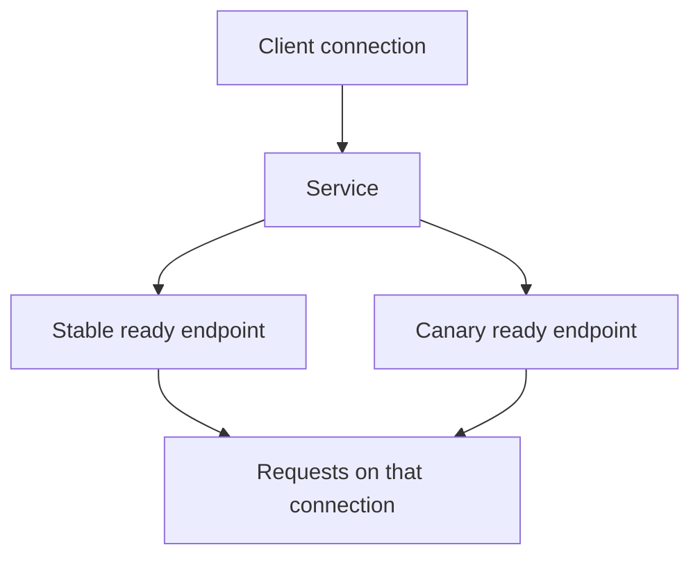

# Reasoning About Canary Traffic With Ordinary Services

Suppose four ready application Pods run the established version and one runs a replacement. Including all five behind a Service introduces the replacement to real traffic. It does not tell you how many requests, users or operations will reach that replacement.

## Learning objectives

- Calculate the canary share of eligible backend Pods.
- Explain why connection reuse can change observed request proportions.
- Choose version-specific evidence for promotion or withdrawal.

## Before you start

Use a shell on your own machine with the module playground running. A Pod is Kubernetes's unit for running one or more containers together. The environment provides the `probe` Deployment, which maintains application Pods, and the `starfleet` namespace, which groups these objects.

Read-only commands below use kubectl, the Kubernetes command-line tool. Select the private kubeconfig: the file that identifies this environment's cluster and credentials. The commands do not change the application.

## Reasoning About Canary Traffic With Ordinary Services

A canary release exposes a new application version to a limited share of traffic before wider promotion. With ordinary Kubernetes Services, a simple design selects ready Pods from both stable and canary Deployments. The share of backend Pods provides an approximate traffic influence, but the Service does not offer a general per-version percentage field.

## Declare Shared And Distinct Labels

Consider stable Pods labelled `app: scout, track: stable` and canary Pods labelled `app: scout, track: canary`. Separate Deployment selectors keep ownership distinct. A public Service selecting `app: scout` includes both eligible sets. A preview Service selecting the canary track can support checks of that version alone.

A selector requiring `track: stable` excludes the canary, even if a canary Deployment exists. Conversely, reusing an overly broad ownership selector across controllers can make resource relationships harder to reason about. Service selection and controller ownership should be reviewed independently before analysing traffic behavior.

Backend readiness changes the effective pool. Four desired stable replicas and one desired canary replica do not necessarily produce five usable endpoints. If two stable Pods are unready, the new version's share among eligible backends is larger than the desired replica counts suggest. Count ready eligible endpoints when estimating exposure.

## Understand The Limits Of Replica Ratios

If four stable endpoints and one canary endpoint are eligible, one fifth of the pool belongs to the canary. Under simplified selection assumptions this can suggest roughly twenty percent of new backend selections. It does not guarantee twenty percent of HTTP requests, bytes, users or successful operations.

Hypertext Transfer Protocol (HTTP) clients can reuse connections, and a chosen connection can carry many requests. Session affinity can preserve a client's backend relationship. Different network implementations and connection patterns influence observed distribution. A small number of observations may therefore look uneven without proving the selector is wrong.

Changing replica counts also changes capacity. Raising canary replicas can increase exposure while raising total application resource use. Reducing stable replicas to preserve the same total can lower the capacity of the known version. Traffic proportion and resource availability should be evaluated together.

## Choose Meaningful Promotion Evidence

Compare error rate, response latency and correct business behavior by version, using labels or another reliable version identity in the signals. A total error count without traffic volume can be misleading: a version receiving fewer requests may show fewer errors while failing a larger proportion of them.

Readiness indicates whether a Pod should receive ordinary Service traffic according to its configured checks. It does not establish that a new release handles every important request correctly. A shallow readiness endpoint may pass while a particular report operation fails. Promotion criteria should include the application behavior the release is meant to preserve.

If exact weighting or user-based routing is required, an ordinary Service selector is insufficient by itself. An application-aware routing layer can provide such policies when installed and configured, but those capabilities should not be assumed in a plain Kubernetes question. Identify the mechanisms actually available in the stated scenario.

## Withdrawal And Promotion

Withdrawing a canary can remove its eligible endpoints by changing its scale or routing selection. Scaling the canary to zero removes capacity; changing selection preserves running preview capacity but changes the public routing pool. Existing connections and propagation still require consideration.

Promotion requires a deliberate desired state, not just leaving two Deployment names indefinitely. The team can update the stable release or make the new version the intended active set, while controlling old-version capacity and compatibility. A successful traffic experiment does not automatically clean up release objects or preserve a reliable rollback path.

Record the image identity, effective endpoints, observation window and criteria used for the decision. Those facts explain whether the canary was exposed as intended and whether the evidence supports broader use. A memorized ratio without those conditions is not a sufficient release argument.

## Inspect the mechanism

A Service selects backends; it does not count business operations. Consider a client that opens one connection and sends one hundred requests through it. If that connection reaches the canary, all hundred can use that version. Another client might open a new connection for each request and produce a different distribution with the same backend pool.

The first useful calculation therefore concerns eligible endpoints. If four stable Pods are ready and the only canary is not ready, ordinary ready endpoints provide no canary exposure. If two stable Pods become unready while the canary remains ready, its share of the three eligible backends becomes one third. Desired replicas alone conceal both cases.



Several requests can use one selected backend, so endpoint proportions do not guarantee request proportions.

<!-- astrona:playground:renew -->

Select the private cluster connection and inspect the live state from your host shell:

```sh
export KUBECONFIG="$(astrona kubeconfig ats-001-playground-010-03)"
if test "$(kubectl config current-context)" = "kind-astro-ats-001-playground-010-03"; then
  kubectl -n starfleet get deployment probe -o jsonpath='{.spec.replicas}{"\n"}'
  kubectl -n starfleet get pods -l app=probe --show-labels
  kubectl -n starfleet get endpointslices -l kubernetes.io/service-name=probe -o yaml
else
  printf "Select this module's private kubeconfig before continuing.\n" >&2
fi
```

The first command reads desired replicas through JSONPath, a field-selection expression. Compare that number with ready Pods and the EndpointSlice conditions. The initial fixture has no separate canary, so do not interpret its two replicas as two versions. This read-only inspection shows which facts must be measured before calculating exposure in a mixed-version pool.

You can now explain what a replica ratio measures and what it leaves uncertain. Promotion still needs meaningful observations tied to the actual version and operation, rather than a guessed percentage.

## Common pitfalls

> [!WARNING]
> Backend count is not a guaranteed request percentage. Readiness, persistent connections, affinity and uneven traffic can change exposure, so evaluate actual version-specific behavior before promotion.
