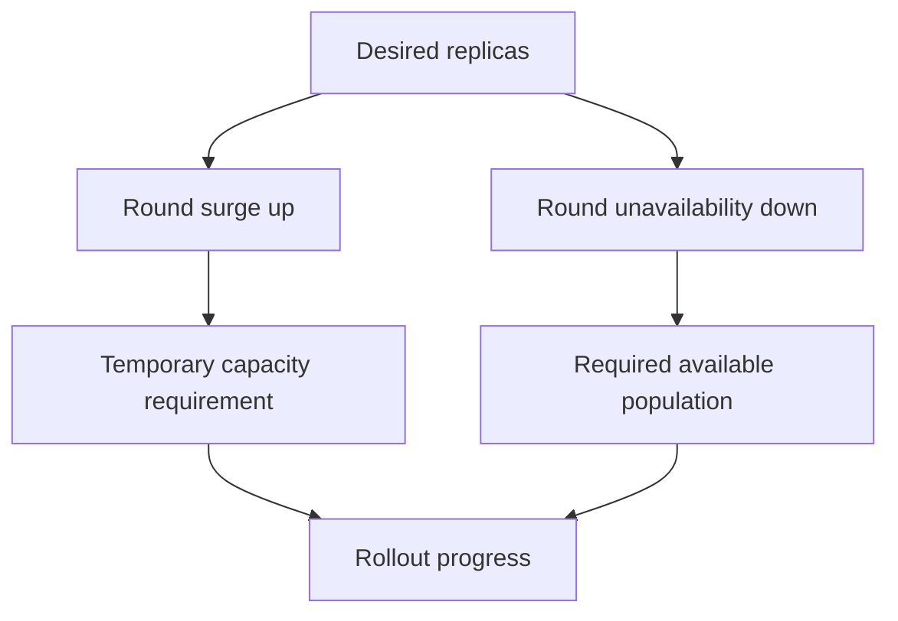

# Calculating Rollout Capacity And Diagnosing Progress

Three desired replicas and a twenty-five percent surge allowance permit one extra Pod. The same percentage for unavailability permits zero unavailable replicas. Understanding the different rounding rules explains why a small Deployment may need spare capacity before any old Pod can be removed.

## Learning objectives

- Calculate integer surge and unavailability budgets from percentages.
- Distinguish a progress condition from an automatic recovery action.
- Select Pod evidence for a rollout blocked by scheduling or readiness.

## Before you start

Use a shell on your own machine with the module playground running. A Pod is Kubernetes's unit for running one or more containers together. The environment provides the `probe` Deployment, which maintains application Pods, and the `starfleet` namespace, which groups these objects.

Read-only commands below use kubectl, the Kubernetes command-line tool. Select the private kubeconfig: the file that identifies this environment's cluster and credentials. The commands do not change the application.

## Calculating Rollout Capacity and Diagnosing Progress

A Deployment rollout replaces Pods after its Pod template changes. Its rolling-update strategy controls how much additional capacity can be created and how much intended capacity can be unavailable during the transition. These controls constrain controller behavior; they do not promise that the application will serve every request correctly.

## Identify Which Change Creates A Revision

The Pod template contains fields such as container images, environment variables and template labels. Changing that template normally creates a new ReplicaSet for a Deployment rollout. Changing the top-level desired replica count is a scaling action and does not by itself describe a new application revision.

Updating a ConfigMap without changing the Deployment template does not automatically create a new Deployment revision. Mounted configuration may propagate according to its delivery semantics, while process environment variables are fixed at container startup. The desired rollout behavior depends on both the template and the application's configuration-consumption method.

A Deployment revision tracks a Pod-template history. It does not capture every external object used by the application. An image tag may refer to changed bytes later, and a Secret can change independently. Reverting a template therefore cannot be assumed to restore every dependency or artifact used by an earlier successful release.

## Work Through Surge And Unavailability

`maxSurge` limits extra Pods above the desired replica count during an update. `maxUnavailable` limits permitted unavailability relative to the desired count. Each can be an integer or a percentage. Percentage surge values round up, while percentage unavailability values round down.

For a Deployment with four desired replicas and both values set to twenty-five percent, the numerical limits are one extra Pod and one unavailable Pod. With three desired replicas, the same percentages allow one surge Pod and zero unavailable Pods. Rounding changes the result, especially for small workloads.

A setting of zero unavailable Pods requires replacement capacity to become available before old capacity is reduced under that budget. The cluster must be able to schedule and run the necessary surge. If resources are exhausted, the new Pod can stay Pending while the old Pods remain, and the rollout can stop making progress.

Terminating Pods can retain resources while shutdown completes, so actual resource use can temporarily exceed a simple desired-plus-surge estimate. Resource planning should consider termination behavior and implementation details instead of treating the arithmetic as an absolute memory ceiling for the namespace.

## Availability Depends On Health

A Pod that starts successfully can remain unready. Readiness checks and `minReadySeconds`, when configured, influence when a replacement contributes to Deployment availability. An incorrect check can either admit unusable capacity or prevent useful capacity from being counted.

`progressDeadlineSeconds` bounds how long a rollout can fail to make required progress before the Deployment reports a progress condition indicating a deadline was exceeded. Reporting that failure does not automatically roll back the application. The author must interpret the condition and choose an appropriate correction.

Paused rollout behavior is separate again: pausing controls progression of template updates according to Deployment semantics. It does not repair a crashing process, create missing storage or make an image available. Describe the requested outcome before selecting a lifecycle control.

## Select Evidence At The Correct Level

A stuck update can result from an unavailable image, missing configuration, scheduling constraints or failed readiness. Compare desired replicas, updated replicas, available replicas and the new Pods' states. Events and container status can show whether failure happens before startup or after the process is running.

If a new image repeatedly exits, increasing surge might create more failing attempts without improving availability. If all new Pods remain Pending because of requests that cannot fit, changing readiness probes cannot solve placement. The relevant condition determines the correction.

A rollback uses retained template history and can itself need resources and time. Earlier compatibility, external configuration and current data must still permit the earlier template to work. Preserve evidence about the failure before replacing the version so the same defect is not promoted again later.

## Inspect the mechanism

Work through the arithmetic before changing strategy. For three replicas, twenty-five percent is 0.75. Surge rounds up to one; unavailability rounds down to zero. Kubernetes can create a replacement, but it must count as available before reducing the old available population under that budget. If the replacement cannot schedule, changing its readiness path has no effect on that placement failure.

With ten replicas and the same percentages, surge becomes three and unavailability becomes two. The difference is not a different algorithm: the desired count changed. Also account for Pods still terminating, which can retain memory and other resources during their shutdown. These calculations describe rollout constraints, rather than an exact ceiling on all resource consumption.



Both temporary capacity and available replacement capacity constrain the same rollout.

<!-- astrona:playground:renew -->

Select the private cluster connection and inspect the live state from your host shell:

```sh
export KUBECONFIG="$(astrona kubeconfig ats-001-playground-020-03)"
if test "$(kubectl config current-context)" = "kind-astro-ats-001-playground-020-03"; then
  kubectl -n starfleet get deployment probe -o jsonpath='{.spec.replicas}{"\n"}{.spec.strategy.rollingUpdate}{"\n"}{.status.conditions}{"\n"}'
  kubectl -n starfleet describe deployment probe
  kubectl -n starfleet get pods -l app=probe
else
  printf "Select this module's private kubeconfig before continuing.\n" >&2
fi
```

Use the actual stored values rather than assuming defaults from a remembered example. `describe` combines object fields and related events into a diagnostic view. If a rollout is blocked, inspect the replacement Pods: Pending placement and Running-but-unready states point to different causes. The starting two-replica Deployment lets you calculate its budgets without initiating a release.

You can now calculate the controller budget and explain a stalled update using Pod evidence. The chosen correction must address the cause; a larger allowance does not repair an invalid image or a failed application check.

## Common pitfalls

> [!WARNING]
> Rollout budgets are controller limits, not guarantees of correct requests. Percentage rounding, readiness, surge capacity and external dependencies all affect progress, and a deadline condition does not automatically trigger rollback.
