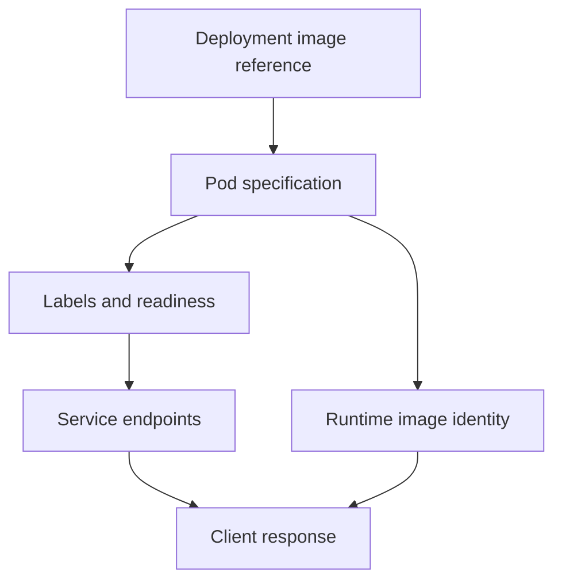

# Intended Versions And Observed Progress

Users receive an older response even though the `probe` Deployment declares a new image. The declaration, running containers and selected network backends can disagree during a release. Diagnose each boundary before deciding that the image build failed.

## Learning objectives

- Compare declared image references with running image identities.
- Trace ready application Pods into Service endpoints.
- Distinguish rollout progress from the version observed by a client.

## Before you start

Use a shell on your own machine with the module playground running. A Pod is Kubernetes's unit for running one or more containers together. The environment provides the `probe` Deployment, which maintains application Pods, and the `starfleet` namespace, which groups these objects.

Read-only commands below use kubectl, the Kubernetes command-line tool. Select the private kubeconfig: the file that identifies this environment's cluster and credentials. The commands do not change the application.

## Intended Versions and Observed Progress

The team requests version two of `scout`, but users still receive version one responses. A release declaration describes intent; the live replica set, images and traffic path show what users can actually reach. A rollout can be partially complete while old and new versions coexist.

Compare the desired Pod template with observed replicas and their artifact identities. A mutable tag can hide differences between containers whose image strings match. A digest provides stronger artifact identity. Labels help identify versions, but a label alone does not prove which bytes are running.

Read availability and rollout conditions with events and probe evidence. A new Pod that cannot schedule contributes no new serving capacity. A new container that starts but fails readiness can leave old replicas serving traffic. A failed startup or liveness check may produce repeated restarts instead.

The traffic configuration can also send users to the wrong workload. A Service selector that matches only old Pods or a route pointing to a previous backend can preserve old behavior after new Pods become healthy. Deployment status and traffic destination therefore need separate checks.

A progress deadline signals that expected progress has not occurred. It does not identify every possible cause or establish that an automatic rollback happened. Check the controller's observed state and the release system's actual actions.

For a stale-version symptom, follow the chain from declared artifact to created replicas, readiness, endpoint selection and response behavior. If the new replicas are not ready, repair their startup or configuration. If they are ready but receive no traffic, examine selection and routing rather than rebuilding the same image blindly.

## Reconciling The Release Record With User Traffic

The release record states digest A, the Deployment template requests it, and new Pods report the expected artifact. These observations establish increasingly concrete evidence of version selection. The final question is whether the user's request reaches those Pods and receives their intended behavior.

A Service selector can still target old labels. A gateway can still reference an earlier backend. A client can retain an old connection while replacement progresses. A complete diagnosis follows the actual traffic path instead of equating new Pod creation with universal exposure.

Conversely, mixed responses during a rolling update can be expected because old and new replicas coexist. The application should support that overlap, and the release observer should compare against the current rollout phase. Mixed responses after the old replicas and routes are gone suggest a different source, such as caching or another environment.

## Probe Failures And False Confidence

A readiness check hitting the wrong port can block healthy application instances. A readiness endpoint that returns success without verifying critical behavior can admit unhealthy ones. Both are configuration or design issues, but their symptoms point in opposite directions. Diagnose what the check actually measures before changing its threshold.

If a new container is repeatedly restarted by liveness, the rollout may never gain stable availability. A slow initialization protected by startup behavior has a different contract. A failed probe is therefore meaningful only with its type, target and triggering action.

Track the latest template generation, observed controller progress, replica population and routing evidence. An old event can explain a past failure but not the current revision. These details help establish whether the release is still blocked, has recovered or completed with an application-level regression that requires further correction.

## Inspect the mechanism

Start with three separate facts: what the Deployment requests, what each container actually uses, and which Pods the Service can reach. The Pod template supplies the requested image. Container status reports the runtime image identity after startup. Labels and readiness feed endpoint selection; they do not validate application bytes.

A mutable tag can keep the declared string unchanged while its underlying content changes. Conversely, the intended digest can be running correctly while a Service selects old labels. These cases require different corrections. Rebuilding an image cannot repair a routing selector, and editing a selector cannot fix a container that never started.



The served version depends on both running content and the traffic path that reaches it.

<!-- astrona:playground:renew -->

Select the private cluster connection and inspect the live state from your host shell:

```sh
export KUBECONFIG="$(astrona kubeconfig ats-001-playground-020-04)"
if test "$(kubectl config current-context)" = "kind-astro-ats-001-playground-020-04"; then
  kubectl -n starfleet get deployment probe -o jsonpath='{.spec.template.spec.containers[0].image}{"\n"}'
  kubectl -n starfleet get pods -l app=probe -o jsonpath='{range .items[*]}{.metadata.name}{" "}{.status.containerStatuses[0].imageID}{"\n"}{end}'
  kubectl -n starfleet get endpointslices -l kubernetes.io/service-name=probe -o yaml
else
  printf "Select this module's private kubeconfig before continuing.\n" >&2
fi
```

Compare declared reference, reported runtime identity and selected Pod addresses. An absent `imageID` can mean startup has not reached the point where the runtime supplies it; inspect status before drawing a conclusion. These commands show current control-plane evidence. A client response remains a separate observation, and actual digests must come from this environment rather than an example value.

You can now distinguish intended version, realized image and exposed backend. Their agreement narrows the investigation, but only a representative application request establishes the behavior seen by a caller.

## Common pitfalls

> [!WARNING]
> Labels and desired image strings do not prove the served version. A failed progress condition is evidence of a stalled rollout, not proof of an automatic rollback.
