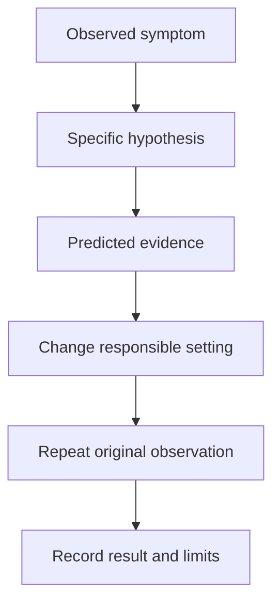

# Reproduce, Correct And Verify

The `probe` container runs, but its readiness check uses an obsolete listener port. A precise correction changes that port relationship and then checks the original request again. Changing unrelated settings at the same time makes the result harder to explain.

## Learning objectives

- State a testable hypothesis for an application release failure.
- Select evidence before changing a declarative resource.
- Verify a correction against the original symptom and caller.

## Before you start

Use a shell on your own machine with the module playground running. A Pod is Kubernetes's unit for running one or more containers together. The environment provides the `probe` Deployment, which maintains application Pods, and the `starfleet` namespace, which groups these objects.

Read-only commands below use kubectl, the Kubernetes command-line tool. Select the private kubeconfig: the file that identifies this environment's cluster and credentials. The commands do not change the application.

## Reproduce, Correct and Verify

A failed release needs a correction that preserves the original application requirements. Start with a clear symptom and a bounded hypothesis. For example, the new application listens on a different port while the readiness check still uses the old one. This predicts a running process, failed probe connections and a rollout without usable new replicas.

Reproduction should keep the relevant version, configuration and request conditions. Simplifying unrelated features helps, but changing the caller identity, storage or dependency version can remove the condition that causes the failure. Record which conditions are essential to the observed result.

A correction changes the source of the supported problem: the listener configuration, probe, image or dependency setting. In a declarative workflow, record the intended change so a controller does not later restore the faulty value. Avoid compensating manual edits that leave the configuration source inconsistent.

Verification needs more than the absence of one error. Confirm the rollout reaches the intended version, replicas become ready, traffic reaches them and representative application operations work. Watch for regressions in error rate, latency and data behavior. Keep the comparison window and workload meaningful.

Rollback can reduce impact when the previous version remains compatible with current data and configuration. A database migration, removed credential or changed protocol can make that assumption false. If reversal is unsafe, a forward correction may be required. The recovery decision should use compatibility evidence rather than only the age of the previous image.

A useful incident record states the cause, evidence, correction and checks performed. That record supports a regression check and improves future release gates. It should explain why the fix worked, not merely list the commands someone attempted.

## Keeping The Investigation Controlled

Write a bounded hypothesis before a correction. If the application moved its listener from 8080 to 9000 while the probe remained at 8080, the prediction is a running process with failed checks at the obsolete port. A correction to the intended listener contract should change readiness without needing unrelated permission or node changes.

Record the configuration source and the affected revision. In GitOps, a direct live edit can be overwritten unless intent is changed through the managed source or an explicit exception procedure. A fix that survives only until the next reconciliation is an incomplete correction.

Verification should preserve the original caller and operation. Confirm the expected artifact is running, its replicas are eligible, traffic reaches them and the critical behavior succeeds. Compare error and latency evidence over an appropriate period instead of relying on one convenient request immediately after the edit.

## Choosing Reversal Or Forward Correction

An earlier application version is a candidate for rollback only if it still works with present configuration and data. A schema migration can invalidate that condition. A removed external API can do the same. Recovery may then require a forward fix, a coordinated restoration or another application-specific procedure.

A traffic reversal can reduce exposure more quickly than rebuilding, but it also needs compatibility checks for shared state. A previous healthy environment can be stale or unable to consume new data. State the recovery assumptions explicitly so the decision is reviewable.

A final record should distinguish root cause, contributing conditions and observations. It should describe the actual change and the checks that support recovery. That record can guide a focused regression check or release gate, reducing future dependence on emergency manual debugging.

## Inspect the mechanism

A useful hypothesis predicts observable evidence. If readiness targets the wrong port, the process may stay Running while probe events report connection failures and ready endpoints disappear. If the Pod instead remains Pending without a node, that prediction is wrong: the failure occurs before the probe can run.

Preserve evidence before editing. The Deployment template, Pod container status and Service port mapping describe different parts of the contract. Match the listener used by the process, the probe target and the Service target port. Then identify which source owns the wrong value. A correction that changes only live state may be overwritten by a separate deployment system.



A correction is supported when the predicted cause and the original symptom both change as expected.

<!-- astrona:playground:renew -->

Select the private cluster connection and inspect the live state from your host shell:

```sh
export KUBECONFIG="$(astrona kubeconfig ats-001-playground-020-04)"
if test "$(kubectl config current-context)" = "kind-astro-ats-001-playground-020-04"; then
  kubectl -n starfleet get deployment probe -o yaml
  kubectl -n starfleet describe pods -l app=probe
  kubectl -n starfleet get service probe -o yaml
else
  printf "Select this module's private kubeconfig before continuing.\n" >&2
fi
```

Find the container's named port, the readiness probe's target and the Service's `targetPort`. `describe pods` includes current state and available events, which may expire and should not be treated as permanent history. The fixture's listener contract is consistent; this inspection demonstrates the evidence needed to evaluate the wrong-port hypothesis without deliberately damaging the environment.

You can now explain why a change should repair a specific failure and what evidence would contradict that explanation. Recovery still requires checking compatibility and recording the intended configuration, rather than accepting a transient improvement.

## Common pitfalls

> [!WARNING]
> Reverting an image without checking data and configuration compatibility can create another failure. Verification must include the intended version and representative user behavior.
