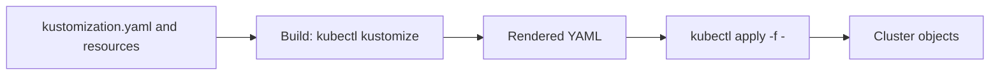

# Build Output And Common Transformers

A team applies a Kustomize directory and the Deployment in the cluster has a different name, namespace and image tag than the files in the base. Nothing in the base was edited. The difference comes from transformers, which are fields in `kustomization.yaml` that rewrite every matching resource during the build. This part shows what the build prints, how `kubectl` uses it, and which transformers an exam task most often needs.

## Learning objectives

- Distinguish building a kustomization from applying it.
- Use `namePrefix`, `namespace`, `labels`, `images` and `replicas` to change a base.
- Explain why `labels` is safer than `commonLabels` on an existing Deployment.

## Build, then apply

A kustomization is a directory that contains a file named `kustomization.yaml`. Kustomize reads that file, loads the listed resources, applies the listed transformers and prints one stream of plain Kubernetes YAML. This step is called the build. The build runs on your machine and never contacts the cluster.

Kubernetes ships Kustomize inside `kubectl`, so these two commands give the same build output. The standalone `kustomize build` command only exists when you install Kustomize separately, and its version can differ from the one inside `kubectl`.

```sh
kubectl kustomize DIRECTORY
kustomize build DIRECTORY
```

The `-k` flag tells `kubectl` to build a directory first and then act on the result. It works with `apply`, `get`, `delete`, `diff` and `describe`. `kubectl apply -k DIRECTORY` is the same as building and then running `kubectl apply -f` on the output. `kubectl delete -k DIRECTORY` deletes exactly the objects that the build produces, so it removes the renamed copies and not the original names.



The cluster only ever receives the rendered YAML. It does not know that a base or an overlay existed.

## A small base to transform

<!-- astrona:playground:renew -->

Create a directory for this part and save one Deployment in it. The Deployment uses a busybox image so that only the build output matters.

```sh
mkdir -p crew-base
```

Save this as `crew-base/deployment.yaml`:

```yaml
apiVersion: apps/v1
kind: Deployment
metadata:
  name: crew
spec:
  replicas: 1
  selector:
    matchLabels:
      app: crew
  template:
    metadata:
      labels:
        app: crew
    spec:
      containers:
      - name: crew
        image: docker.io/library/busybox:1.37.0
        command: ["sh", "-c", "sleep 3600"]
```

Save this as `crew-base/kustomization.yaml`:

```yaml
apiVersion: kustomize.config.k8s.io/v1beta1
kind: Kustomization
resources:
- deployment.yaml
```

Render it and confirm that the output matches the file.

```sh
kubectl kustomize crew-base
```

## The common transformers

Each transformer below is a top-level field of `kustomization.yaml`. Save this as `crew-base/kustomization.yaml`, replacing the earlier file:

```yaml
apiVersion: kustomize.config.k8s.io/v1beta1
kind: Kustomization
resources:
- deployment.yaml
namePrefix: dev-
namespace: starfleet
labels:
- pairs:
    environment: dev
images:
- name: docker.io/library/busybox
  newTag: "1.36.1"
replicas:
- name: crew
  count: 3
```

Each field changes the build output in a fixed way:

- `namePrefix` puts `dev-` in front of the name of every resource. A `nameSuffix` field does the same at the end. Kustomize also updates references that it understands, such as a Pod volume that points at a ConfigMap that was renamed.
- `namespace` sets `metadata.namespace` on every namespaced resource.
- `labels` adds the listed pairs to `metadata.labels` of every resource. With `includeTemplates: true` it also adds them to Pod template labels. With `includeSelectors: true` it adds them to selectors too. Both options default to false.
- `images` matches containers by image name, without the tag, and sets a new name, a new tag or a digest. The Deployment file keeps its original image.
- `replicas` sets the replica count of a Deployment, StatefulSet or ReplicaSet that is named in the field. The name must be the original name, not the prefixed name.

Render again and check the name, namespace, labels, image and replica count in the output.

```sh
kubectl kustomize crew-base
```

Expected: the Deployment is named `dev-crew`, sits in the `starfleet` namespace, has the label `environment: dev`, uses the image `docker.io/library/busybox:1.36.1` and has three replicas. The Pod template labels and the selector stay `app: crew`. The exact line order in the output is decided by Kustomize and is not shown here.

## Why labels and not commonLabels

An older field named `commonLabels` still works. It adds labels to metadata, to Pod templates and to selectors, all at once. A Deployment's `spec.selector` cannot be changed after the Deployment exists, so applying a new `commonLabels` value to a live Deployment fails with an immutable-field error. The newer `labels` field leaves selectors alone unless you ask for `includeSelectors`. Use `labels` for anything you apply on top of existing objects.

## Common pitfalls

> [!WARNING]
> The `replicas` transformer matches the resource name in the files, before `namePrefix` is applied. If the count does not change, compare the name in the transformer with the name in `deployment.yaml`, not with the name in the build output. Also remember that `kubectl delete -k` deletes the renamed objects, so run it only with the same directory that created them.
