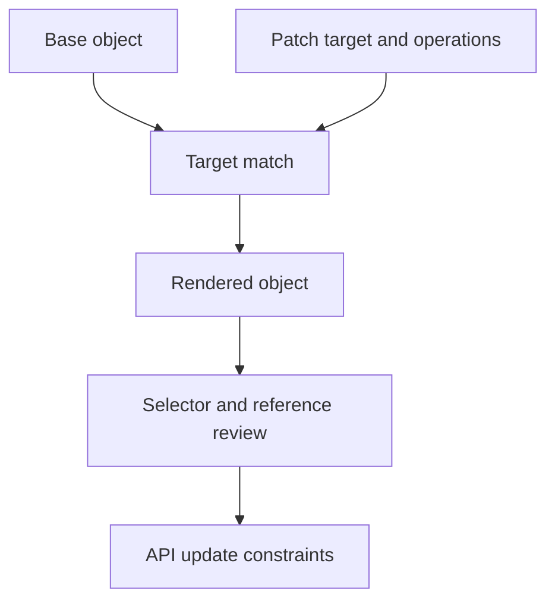

# Targeted Patches And Environment Differences

A patch should raise `probe` replicas without deleting its sidecar or changing which Pods the Deployment owns. A short patch is useful only when its merge behavior preserves those unrelated relationships.

## Learning objectives

- Choose a precise object target for an overlay patch.
- Compare schema-aware list merging with positional JSON patching.
- Identify immutable selectors and unintended rendered changes.

## Before you start

Use a shell on your own machine with the module playground running. A Pod is Kubernetes's unit for running one or more containers together. The environment provides the `probe` Deployment, which maintains application Pods, and the `starfleet` namespace, which groups these objects.

Read-only commands below use kubectl, the Kubernetes command-line tool. Select the private kubeconfig: the file that identifies this environment's cluster and credentials. The commands do not change the application.

## Targeted Patches and Environment Differences

A Kustomize overlay changes a reusable resource composition for a particular use. A patch specifies a change to matching objects instead of duplicating their complete definitions. The design goal is to make the intended difference explicit while preserving the relationships required by the application.

## Decide Which Input Owns A Setting

Imagine a shared `scout` base with one Deployment and one Service. The production overlay needs more replicas, a specific image digest and a production configuration object. Those differences belong in the overlay, while common container names, selectors and basic port relationships can remain in the base.

The same setting should not have several unclear owners. If an image transformer changes a field that a later patch also changes, the effective result depends on transformation behavior and ordering. A reviewer should be able to identify which declaration expresses the final image and why. Avoid redundant changes merely because each individual input looks reasonable.

A separate environment is not always just a namespace transform. It can have different external dependencies, capacity requirements and security settings. Explicitly record those differences rather than assuming that placing the same resources in another namespace reproduces a complete working environment.

## Match The Intended Object

A patch target can select objects by group, version, kind, name, namespace or supported label selectors. A broad target can unintentionally change several Deployments. A narrow target that no longer matches a renamed resource can leave the intended object unmodified. Review the rendered objects to establish what actually matched.

Resource names can change through prefixes, suffixes and generators, so matching should be understood under the tool's transformation rules. Guessing from a final display name is not enough to infer which input a patch selected. Keep the target's identity and the composition's naming strategy consistent.

Patches also need to respect immutable fields. A Deployment selector generally cannot be changed on an existing Deployment through an ordinary update. Altering an environment's desired labels should not casually rewrite ownership identity. Template labels and Service selection can often express the intended routing change without modifying that immutable selector.

## Understand Patch Semantics

A strategic merge patch uses schema-aware merging where supported. Named elements in some lists can be matched by a merge key, such as a container name. This is different from treating every list as an append-only sequence. Custom resources and fields without matching schema support can require different handling.

A JSON patch describes ordered operations such as adding, replacing or removing at explicit document paths. JavaScript Object Notation (JSON) is a structured data representation; the patch format operates on the corresponding object structure even when source files use YAML. A numeric list position can be brittle if another input changes the list order.

A replacement operation expects the relevant target location according to its semantics. Removing the wrong path or changing a container by an assumed position can alter another part of the workload. Prefer a clear, stable target and understand whether the operation adds a new value or replaces an existing one.

## Review A Concrete Difference

Suppose a production patch is intended to increase `scout` replicas and change only the application container's resource requests. The rendered Deployment should still contain its helper container, the original selector and matching template labels. If the patch replaces the whole container list accidentally, the helper can disappear while the output remains valid YAML.

The correct review compares final behavior, not just file length. Inspect workload identity, containers, references, resources and Service routing. Then check whether the API schema accepts the resulting fields. A build step succeeding is evidence that composition completed; it is not proof that the application contract was preserved.

Overlays should remain understandable as a set of deliberate differences. If every field is patched independently, the supposed base may no longer represent a useful common application. Refine the shared input instead of accumulating contradictory transformations that are difficult to verify.

## Inspect the mechanism

Consider a Deployment with two named containers. A supported strategic merge uses the container name as a merge key, so a patch for `probe` can leave its helper intact. A JavaScript Object Notation (JSON) patch that targets `/spec/template/spec/containers/0` selects a position instead. Reordering the input list can make that position identify another container.

The rendered Deployment is the evidence of what matched and changed. Compare its complete container list, Pod labels and ownership selector, not only the field named in the patch. The selector identifies Pods that belong to the Deployment; changing it on an existing Deployment is generally not a permitted ordinary update. A patch can produce syntactically valid output that the API still rejects.



A matching patch must also preserve resource relationships and satisfy the API's update rules.

<!-- astrona:playground:renew -->

Select the private cluster connection and inspect the live state from your host shell:

```sh
export KUBECONFIG="$(astrona kubeconfig ats-001-playground-030-03)"
if test "$(kubectl config current-context)" = "kind-astro-ats-001-playground-030-03"; then
  kubectl -n starfleet get deployment probe -o jsonpath='{.spec.selector.matchLabels}{"\n"}{.spec.template.metadata.labels}{"\n"}{range .spec.template.spec.containers[*]}{.name}{"\n"}{end}'
else
  printf "Select this module's private kubeconfig before continuing.\n" >&2
fi
```

The output separates ownership labels, template labels and container names. Preserve that distinction when reviewing a rendered patch. This command reads the baseline object and changes nothing. A target selector or list merge must be verified against rendered output from your saved composition; there is no patch operation implied by this inspection.

You can now explain why targeting and merge semantics matter independently of YAML validity. The final review concerns the complete resource contract, including fields that the patch was supposed to leave unchanged.

## Common pitfalls

> [!WARNING]
> A patch can match too much, match nothing or replace more structure than intended. Verify the final object and its resource relationships, especially container lists and immutable selectors.
