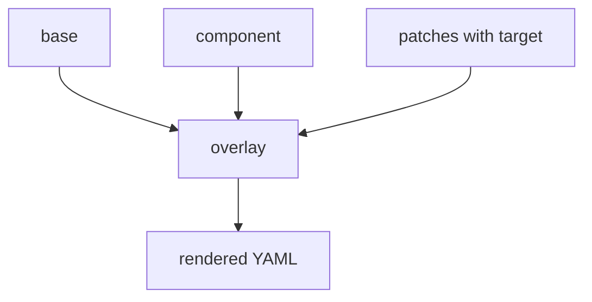

# JSON Patches, Targets And Components

A strategic merge patch needs a full copy of the object's identity: kind, name and the path to the field. Some changes do not fit that shape. You may need to remove one field, add one item to the end of a list, or change every Deployment that has a certain label. Kustomize offers a second patch format and a target selector for these cases.

## Learning objectives

- Write a JSON 6902 patch with the operations `add`, `replace` and `remove`.
- Select resources with a `target` block by kind, name or label.
- Explain what a component is and when to use one.

## The inline patch with a target

The `patches` field accepts both patch formats. Kustomize decides the format from the content: a list of operations is a JSON 6902 patch, and a partial object is a strategic merge patch. The `target` block says which resources receive the patch. Without a target, a strategic merge patch matches by the kind and name written inside the patch itself.

A JSON 6902 patch is a list of operations. Each operation has an `op`, a `path` and, for `add` and `replace`, a `value`. The path uses slashes and is zero-based for lists.

<!-- astrona:playground:renew -->

Create a directory and save a small Deployment with two containers.

```sh
mkdir -p crew-base crew-overlay
```

Save this as `crew-base/deployment.yaml`:

```yaml
apiVersion: apps/v1
kind: Deployment
metadata:
  name: crew
  labels:
    tier: backend
spec:
  replicas: 1
  selector:
    matchLabels:
      app: crew
  template:
    metadata:
      labels:
        app: crew
    spec:
      containers:
      - name: crew
        image: docker.io/library/busybox:1.37.0
        command: ["sh", "-c", "sleep 3600"]
      - name: helper
        image: docker.io/library/busybox:1.37.0
        command: ["sh", "-c", "sleep 3600"]
```

Save this as `crew-base/kustomization.yaml`:

```yaml
apiVersion: kustomize.config.k8s.io/v1beta1
kind: Kustomization
resources:
- deployment.yaml
```

Save this as `crew-overlay/kustomization.yaml`:

```yaml
apiVersion: kustomize.config.k8s.io/v1beta1
kind: Kustomization
resources:
- ../crew-base
patches:
- target:
    kind: Deployment
    labelSelector: tier=backend
  patch: |-
    - op: replace
      path: /spec/replicas
      value: 3
    - op: add
      path: /spec/template/spec/containers/0/env
      value:
      - name: MODE
        value: overlay
    - op: remove
      path: /spec/template/spec/containers/1
```

Render the overlay and read the result.

```sh
kubectl kustomize crew-overlay
```

Expected: the Deployment has three replicas, the first container has an environment variable named `MODE`, and the `helper` container is gone. The target selected the Deployment through its label, so the patch did not need the name `crew`.

## What the target can match

The `target` block can combine these fields. A resource must match all of the fields you write.

- `kind`, `group` and `version` match the resource type.
- `name` and `namespace` match the name and namespace in the base files. Kustomize treats each value as a regular expression that must match the whole name, so `name: crew` matches only `crew`, while `name: crew.*` also matches `crew-extra`.
- `labelSelector` and `annotationSelector` match by metadata, using the same syntax as `kubectl get -l`.

If the target matches nothing, the rendered output can come out without your change, so always read it. If it matches several resources, the patch applies to each one.

## Positions are fragile

The path `/spec/template/spec/containers/1` names a position. If someone later adds a container in front of `helper`, the same patch removes a different container and the build still succeeds. A strategic merge patch names the container instead, and Kustomize matches it by that name. Use a JSON 6902 patch when you need `remove`, `move` or `copy`, or when the target is selected by label. Use a strategic merge patch when you only change fields and the container name is stable.

The `add` operation can append to a list when the path ends in `/-`. For example, the path `/spec/template/spec/containers/-` adds a container at the end.

## Components

A component is a reusable piece of configuration that you can include in several overlays. It lives in its own directory with a file named `kustomization.yaml`, but its `kind` is `Component` and its `apiVersion` is `kustomize.config.k8s.io/v1alpha1`. An overlay lists it under `components`, not under `resources`.

```yaml
apiVersion: kustomize.config.k8s.io/v1alpha1
kind: Component
patches:
- target:
    kind: Deployment
  patch: |-
    - op: add
      path: /spec/template/metadata/annotations
      value:
        owner: platform
```

An overlay that wants this behavior adds `components:` with the relative path to that directory. A component works on whatever resources the including kustomization has already collected, so it suits optional features such as extra annotations, an added sidecar container or a monitoring label.



The overlay collects the base, applies the component and then applies its own patches, so a final patch can correct what a component added.

## Common pitfalls

> [!WARNING]
> A JSON 6902 patch fails the build when its path does not exist, for example `replace` on a field the base does not set. Use `add` for a field that may be missing. Also check the rendered list after any change by position, because the build can succeed while a different container was changed.
