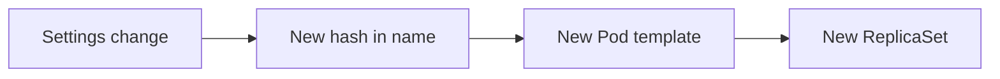

# Generating ConfigMaps And Content Hashes

Application settings change more often than application code. A ConfigMap that is edited in place does not restart the Pods that use it, so the new settings can sit unused for hours. This part shows how a Kustomize generator creates the ConfigMap during the build and ties a new Pod template to every change in its content.

## Learning objectives

- Write a `configMapGenerator` entry with literals, files and environment files.
- Explain why the generated name ends with a hash.
- Predict when a settings change causes a rollout.

## The generator field

A generator is a field in `kustomization.yaml` that creates a resource instead of reading one from a file. The `configMapGenerator` field creates ConfigMaps. Each entry has a `name` and one or more sources.

- `literals` lists `key=value` pairs. Each pair becomes one key in `data`.
- `files` lists file names. Each file becomes one key whose name is the file name and whose value is the file content. The form `key=path` chooses another key name.
- `envs` lists files in `KEY=VALUE` format with one pair per line. Each pair becomes one key.

The source files must be inside the kustomization directory or below it. Kustomize refuses to load files from outside by default.

## The hash suffix

Kustomize does not name the generated ConfigMap `probe-settings`. It adds a dash and a short hash of the content, such as `probe-settings-<HASH>`. The hash changes whenever any key or value changes. Kustomize also rewrites every reference to `probe-settings` that it finds in the same build, such as a `configMap.name` in a volume, a `configMapKeyRef` or an `envFrom` entry, so the Deployment points at the hashed name.

<!-- astrona:playground:renew -->

Save a small kustomization in a new directory to see the result. Create the directory first.

```sh
mkdir -p settings-demo
```

Save this as `settings-demo/deployment.yaml`:

```yaml
apiVersion: apps/v1
kind: Deployment
metadata:
  name: crew
spec:
  replicas: 1
  selector:
    matchLabels:
      app: crew
  template:
    metadata:
      labels:
        app: crew
    spec:
      containers:
      - name: crew
        image: docker.io/library/busybox:1.37.0
        command: ["sh", "-c", "sleep 3600"]
        envFrom:
        - configMapRef:
            name: crew-settings
```

Save this as `settings-demo/kustomization.yaml`:

```yaml
apiVersion: kustomize.config.k8s.io/v1beta1
kind: Kustomization
resources:
- deployment.yaml
configMapGenerator:
- name: crew-settings
  literals:
  - greeting=hello-fleet
```

Render it.

```sh
kubectl kustomize settings-demo
```

Expected: one ConfigMap named `crew-settings-` followed by a hash, with the key `greeting` in its data. The Deployment's `configMapRef` shows the same hashed name. The hash itself depends on the content and is not shown here.

Change `hello-fleet` to `hello-again` in `settings-demo/kustomization.yaml` and render again. The hash changes, and the name in the Deployment changes with it.

## Why this starts a rollout

A Deployment starts a rollout only when its Pod template changes. The new hashed name is part of the Pod template, so the Deployment sees a template change and creates a new ReplicaSet. New Pods read the new settings. If a build produces the same content, it produces the same name and the Deployment stays unchanged. If a new revision fails, a rollback returns to the previous ReplicaSet, which still points at the old ConfigMap.



The change in the name is what turns a settings change into a normal rolling update.

## What the cluster keeps

`kubectl apply -k` creates the new ConfigMap and updates the Deployment. It does not delete the old ConfigMap, because the old name is no longer in the build output. Old ConfigMaps pile up unless you prune them with a label selector or clean them by hand. Rollback needs the old one to exist, so do not remove it right after an upgrade.

## Common pitfalls

> [!WARNING]
> A reference that Kustomize cannot find is not rewritten. If a custom resource or an annotation names the ConfigMap, it keeps the plain name and points at nothing. Always render the build and search the output for the plain name before you apply.
