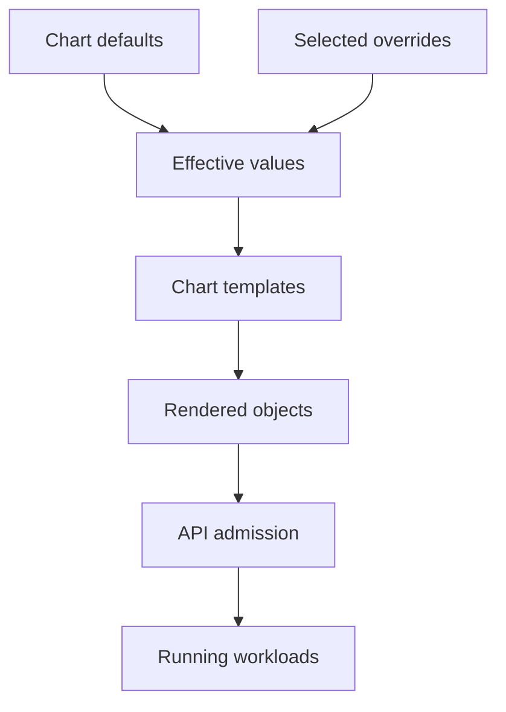

# Charts, Values And The Rendered Application

Setting `replicaCount: 3` changes an application only if its chart template reads that value. Helm values are chart inputs, not Kubernetes fields. Tracing them into rendered resources prevents a plausible-looking override from being mistaken for an effective change.

## Learning objectives

- Distinguish chart version, release name and application image.
- Trace supported values into rendered Kubernetes objects.
- Separate local template rendering from server-side installation.

## Before you start

Use a shell on your own machine with the module playground running. A Pod is Kubernetes's unit for running one or more containers together. The environment provides the `probe` Deployment, which maintains application Pods, and the `starfleet` namespace, which groups these objects.

Read-only commands below use kubectl, the Kubernetes command-line tool. Select the private kubeconfig: the file that identifies this environment's cluster and credentials. The commands do not change the application.

## Charts, Values and The Rendered Application

Helm is a package manager for Kubernetes applications. A chart packages templates, metadata and supporting configuration. Installing a chart creates a release, which is Helm's tracked instance of that chart in an environment. The application still runs through the Kubernetes resources produced by the chart.

## Distinguish Chart And Application Identity

A chart version identifies a version of the package. An application version in chart metadata describes the packaged application's version but is not a universal instruction that overrides container images. The image ultimately used is determined by the rendered resource fields and the chart's own value and template relationships.

A release name identifies an installation, so the same chart can produce separate releases with different names, namespaces or values. Template naming conventions often incorporate that release name. Assuming that a resource has the chart's plain name can lead to looking for the wrong Deployment or Service.

A chart can have dependencies on other charts. Those dependencies introduce resources and configuration relationships that the installer should examine. A package described as an application can include databases, access-control objects or cluster-scoped resources. The apparent size of a values file does not describe the entire deployment footprint.

## Follow Values Into Templates

Values provide inputs to templates. The chart supplies defaults, while the installer can supply files and supported direct overrides. Later value sources generally take precedence in their documented order. The effective rendered object depends on both the final values and how the templates use them.

For example, a value named `service.port` affects a Service only if the chart template reads that value for that field. There is no universal Kubernetes meaning attached to arbitrary chart value names. A value called `replicas` can be ignored if the template instead uses a differently named setting or another scaling mechanism.

Types also matter. A string, boolean and number can produce different template behavior. Some override mechanisms infer types, while others preserve strings explicitly. A value that looks plausible in a command can therefore render an unexpected field or fail chart validation. Understand the chart's documented contract instead of assuming every package uses the same keys.

## Inspect What Will Be Created

Rendering reveals the resource definitions generated from a chart and its values. Review namespaces, workload images, selectors, Service ports, storage claims and requested permissions. A rendered definition can be valid YAML while still using an unsupported API version or referencing a missing dependency.

Client-side rendering does not universally reproduce server-side validation, discovery or admission behavior. Templates that depend on cluster information can also behave differently under the available rendering mode. Treat rendered output as an important review layer rather than an absolute prediction that installation must succeed.

A chart's default resources can be unsuitable for the intended environment. An external Service type might require infrastructure not present in the cluster. A default StorageClass requirement can leave claims Pending. An application may need confidential values that should not be stored in plain repository files or casually included in shared output.

## Interpret Installation Results

Helm tracks release state, but application health still depends on the created resources. The relevant waiting options can wait for selected Kubernetes readiness conditions, not every business operation. A workload can pass a basic readiness check and still fail a particular report request because its database permissions are wrong.

Installation failures can occur during rendering, API submission, hooks or later readiness. Identify which stage failed before editing values. A template error will not be fixed by changing NetworkPolicy, and a scheduling failure will not be fixed by renaming the release.

When using an existing package, the practical reasoning task is to find its supported values, determine its output and connect that output to the application's needs. Memorizing one chart's value names is less useful than tracing the value-to-resource relationship accurately.

## Inspect the mechanism

A chart packages templates and defaults. A release is one installed instance of that chart, identified by name and namespace. The template decides how the final values become object fields. Consequently, two charts can use different names for the same setting, and an unknown key can remain unused unless the chart validates or rejects it.

Treat rendering as a boundary you can inspect. Helm combines the chosen defaults and overrides, renders templates, then submits objects during installation. The server adds its own authorization, validation and admission decisions. A local render can therefore succeed before an installation fails for an unavailable API or a rejected Pod security setting.



Values affect workloads through templates and API submission, rather than acting on Pods directly.

<!-- astrona:playground:renew -->

Select the private cluster connection and inspect the live state from your host shell:

```sh
export KUBECONFIG="$(astrona kubeconfig ats-001-playground-040-03)"
if test "$(kubectl config current-context)" = "kind-astro-ats-001-playground-040-03"; then
  helm version --short
  helm list -n starfleet
  kubectl -n starfleet get deployment probe -o yaml
else
  printf "Select this module's private kubeconfig before continuing.\n" >&2
fi
```

`helm list` reads release records in the selected namespace. The baseline `probe` fixture was created directly, so the absence of a Helm release does not imply the application is absent. Compare that with the Deployment read through kubectl. This establishes the difference between Helm's release inventory and Kubernetes's object inventory before installing a chart.

You can now follow a value to the field it changes and distinguish package identity from running content. An effective override still needs a compatible environment and a meaningful health check after installation.

## Common pitfalls

> [!WARNING]
> Chart versions, application versions and release names describe different identities. Values influence only the fields their templates use, and successful rendering does not prove server acceptance or application correctness.
