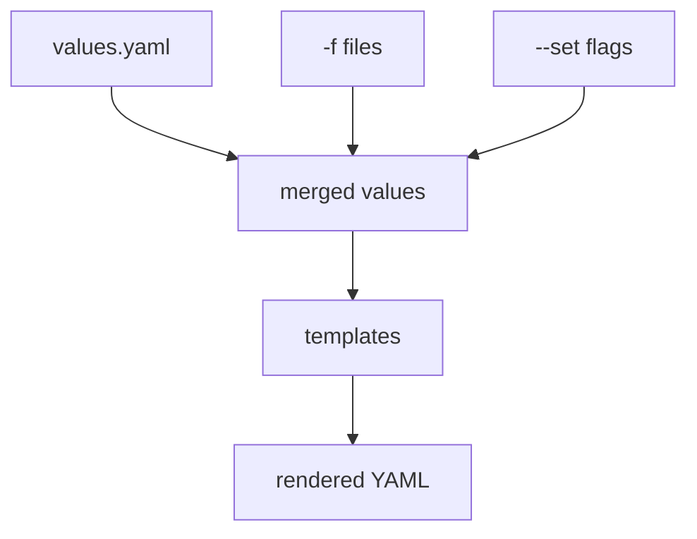

# Values Precedence And Local Rendering

A chart ships with default values, and you rarely want the defaults. You change them with a values file, with `--set` flags, or with both. When two sources set the same key, only one value reaches the rendered object. This part explains the order of precedence, and it shows how to render a chart on your machine so you can see the result before any object reaches the cluster.

## Learning objectives

- Read a chart's default values with `helm show values`.
- Render a chart without installing it, using `helm template` and `helm lint`.
- Predict which value wins when `-f` and `--set` set the same key.
- Tell supplied values apart from computed values with `helm get values`.

## Inspect before you install

A chart is a directory (or an archive of that directory) with a `Chart.yaml` file, a `values.yaml` file with defaults, and templates. `helm show values CHART` prints the defaults without installing anything. It is the first command to run on a chart you did not write, because it lists every setting the author expects you to change.

<!-- astrona:playground:renew -->

Save the chart used in this part. Create the directories first.

```sh
mkdir -p probe-chart/templates
```

Save this as `probe-chart/Chart.yaml`:

```yaml
apiVersion: v2
name: probe-chart
version: 0.1.0
appVersion: v1
type: application
```

Save this as `probe-chart/values.yaml`:

```yaml
replicaCount: 1
version: v1
```

Save this as `probe-chart/templates/application.yaml`:

```yaml
apiVersion: apps/v1
kind: Deployment
metadata:
  name: helm-probe
  namespace: {{ .Release.Namespace }}
spec:
  replicas: {{ .Values.replicaCount }}
  selector:
    matchLabels:
      app: helm-probe
  template:
    metadata:
      labels:
        app: helm-probe
    spec:
      containers:
      - name: probe
        image: docker.io/library/busybox:1.37.0
        command: ["sh", "-c", "sleep 3600"]
        env:
        - name: VERSION
          value: {{ .Values.version | quote }}
```

Check the chart for mistakes, then print its defaults.

```sh
helm lint probe-chart
helm show values probe-chart
```

`helm lint` reports problems in the chart files. The second command prints the two defaults, `replicaCount: 1` and `version: v1`.

## Render without a cluster

`helm template RELEASE CHART` runs the template engine on your machine and prints the Kubernetes YAML. It does not create a release and it does not need a running cluster. The `--namespace` flag sets `.Release.Namespace` in the templates. Without it the value is `default`.

```sh
helm template demo probe-chart --namespace starfleet
```

Expected: one Deployment named `helm-probe` in the namespace `starfleet` with one replica and `VERSION` set to `v1`.

## Which value wins

Helm builds the final values in this order, from lowest to highest priority. The last source that sets a key wins.

1. The chart's own `values.yaml`.
2. Each file passed with `-f` or `--values`, in the order given on the command line.
3. Each `--set`, `--set-string` or `--set-file` flag, in the order given.

Save this as `crew-values.yaml`:

```yaml
replicaCount: 3
version: v2
```

Render with both the file and a flag.

```sh
helm template demo probe-chart --namespace starfleet -f crew-values.yaml --set version=v3
```

Expected: three replicas from the file, and `VERSION` equal to `v3`, because the `--set` flag has the highest priority. Two `-f` files work the same way: the file listed last overrides the earlier one. Values are merged by key, so a file that sets only `version` leaves `replicaCount` at the chart default.

`--set` has parsing rules that can surprise you. It turns `true` into a boolean and `3` into a number. When a template needs the text `"3"` or `"true"`, use `--set-string`. Dots in a key create nested maps, so a key with a literal dot needs a backslash.



Each source overwrites the one above it in the order shown, and the merged values are the only input to the templates.

## Supplied and computed values

After an install, `helm get values RELEASE` prints only the values you supplied, with `-f` and `--set` merged. Adding `--all` prints the computed values, which include the chart defaults. If a release shows an empty result from `helm get values` without `--all`, the release used only chart defaults.

A dry run goes one step further than `helm template`. `helm install RELEASE CHART --dry-run=server` sends the rendered objects to the Kubernetes API server for validation and does not store them. It can catch problems such as an unknown API version that `helm template` cannot see. The value `--dry-run=client` only renders.

## Common pitfalls

> [!WARNING]
> `helm upgrade` does not keep the values of the previous revision unless you add `--reuse-values`. An upgrade with no `-f` or `--set` flags falls back to the chart defaults. Always pass the full set of values again, or use `--reuse-values` on purpose and check the result with `helm get values RELEASE`.
