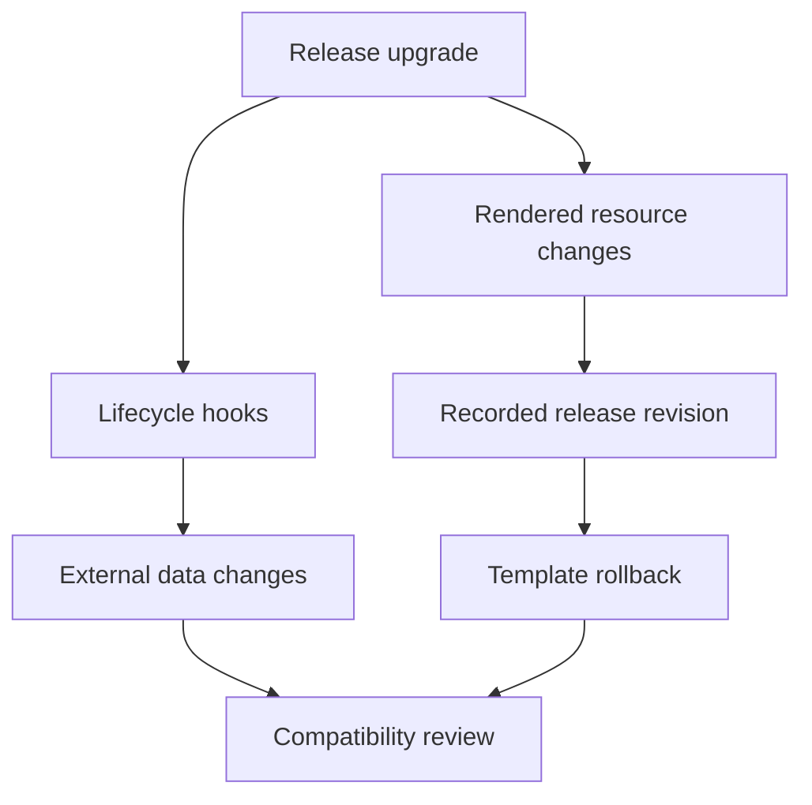

# Release History, Upgrades And Controlled Recovery

A Helm upgrade changes an image and runs a database migration. Returning to the previous release revision may restore templates while leaving the migrated database in place. Recovery needs an explicit account of both kinds of state.

## Learning objectives

- Read release history in the correct namespace.
- Explain which state a release revision records.
- Identify external effects that rollback and uninstall may leave behind.

## Before you start

Use a shell on your own machine with the module playground running. A Pod is Kubernetes's unit for running one or more containers together. The environment provides the `probe` Deployment, which maintains application Pods, and the `starfleet` namespace, which groups these objects.

Read-only commands below use kubectl, the Kubernetes command-line tool. Select the private kubeconfig: the file that identifies this environment's cluster and credentials. The commands do not change the application.

## Release History, Upgrades and Controlled Recovery

A Helm release records an installed chart instance and its revisions. Upgrading a release can change the chart, its values or both, producing a new rendered resource set. Recovery requires knowing which revision and external dependencies represent a working application, rather than treating a revision number as a complete snapshot of every system.

## Identify The Release And Namespace

Release operations are scoped to an identified release and namespace. The same release name can be used in different namespaces according to Helm's supported storage behavior. Inspecting the wrong namespace can make an installed application appear absent even while its Pods continue running elsewhere.

Release history describes revisions and tracked statuses. Status information is useful for distinguishing a deployed revision from failed or superseded attempts. It does not explain every Pod-level failure. The installed manifests, effective values and Kubernetes events provide additional evidence about what a particular revision attempted to create.

An upgrade should deliberately choose its value inputs. Options that reuse earlier values or reset to chart defaults change the effective configuration. A new chart can introduce or rename values, so carrying old values forward without reviewing the new contract can produce unexpected behavior even when the command is accepted.

## Compare Desired Changes With External State

A chart upgrade might change an image, a Service, an access grant and a storage-related reference at once. Each object has its own update rules. An immutable-field change can fail even if the same template would work when creating a brand-new object. Deleting and recreating resources has different availability and data implications from an ordinary update.

Hooks are chart-defined resources used at lifecycle points. A migration Job run through a hook can change external data before a workload becomes healthy. Hook resources can also have lifecycle and retention rules different from the ordinary release resource set. Review those semantics before assuming that all created objects disappear or return to their previous behavior on rollback.

CustomResourceDefinitions require particular care. Helm has special handling for definitions supplied through a chart's dedicated directory, and their upgrade and removal behavior is not identical to ordinary templated objects. A release rollback cannot be assumed to restore an entire custom-resource API lifecycle.

## Waiting And Failure Options

Waiting options observe supported readiness conditions for created resources and have an associated timeout. A timeout can indicate an image, placement, storage or health-check problem. Increasing the timeout helps only when the workload is expected to make progress within the longer window; it does not repair an invalid image reference.

Some Helm versions offer options for restoring or cleaning up changes after a failed operation. Their exact names and semantics depend on the Helm version and operation. Do not infer behavior from a familiar option name without checking the installed version's help and documentation. The core reasoning is to know what is reverted, what is removed and what external effects remain.

A rollback selects a prior release revision for the supported resource restoration process. It still requires current API support, permissions and compatible application data. Returning to an earlier image does not reverse a database schema change performed by a hook or recover data deleted by the application.

## Uninstall And Evidence Retention

Uninstall removes resources according to the release and resource policies. Persistent data, retained objects or hook-created resources can remain under their respective rules. Conversely, deleting a resource that a chart created can affect data if its storage lifecycle removes the backing volume. Review the retention contract before treating uninstall as harmless housekeeping.

For a failed `scout` upgrade, connect the release revision to the effective Deployment image, Pod state and relevant dependency changes. A missing configuration key calls for a configuration correction. A incompatible data migration calls for application-aware recovery. These decisions require more than selecting an earlier history entry.

Keep enough release and application evidence to explain the outcome. Release metadata helps reconstruct the intended change, while resource status and application signals show its effects. Together they support a controlled recovery plan with clearly stated limits.

## Inspect the mechanism

Helm records chart and configuration state for a release. Kubernetes separately records the objects and their current status. A database separately records the data changed by application or migration Jobs. These records have different owners and lifetimes; a revision number does not combine them into a universal snapshot.

Before an upgrade, compare the current installed manifests with the proposed output and identify hooks, persistent claims and immutable fields. A hook is a chart-declared action at a release lifecycle point. It can perform an effect outside the ordinary resource set. Current Helm versions also differ in supported failure-handling options, so inspect the installed command's help before relying on a familiar flag.



Restoring recorded templates still requires compatibility with external state that may have changed.

<!-- astrona:playground:renew -->

Select the private cluster connection and inspect the live state from your host shell:

```sh
export KUBECONFIG="$(astrona kubeconfig ats-001-playground-040-04)"
if test "$(kubectl config current-context)" = "kind-astro-ats-001-playground-040-04"; then
  helm version --short
  helm list -n starfleet
  helm upgrade --help
  helm rollback --help
else
  printf "Select this module's private kubeconfig before continuing.\n" >&2
fi
```

These commands inspect the local Helm version, release inventory and supported operations. No upgrade or rollback runs. If the baseline has no release records, that is consistent with directly created fixtures. When a release exists, its namespace and revision are required inputs for interpreting history; never infer a rollback target from an unrelated application's revision number.

You can now describe the recovery boundary of a release operation. A controlled rollback or uninstall depends on chart policy, current API support, storage retention and application data, rather than on release status alone.

## Common pitfalls

> [!WARNING]
> A release rollback does not undo every external side effect. Review value reuse, immutable fields, hooks, storage retention and the current Helm version's failure-handling options before selecting a recovery action.
