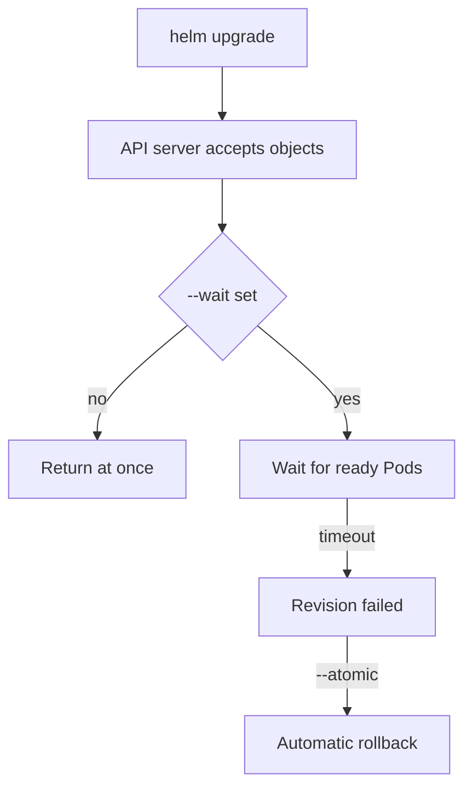

# Uninstall, Wait And Inspecting A Release

A release is a record that Helm stores in the cluster: the chart, the values and the rendered objects of each revision. Day-to-day operation means reading that record, deciding whether an upgrade succeeded, and removing the release when it is no longer needed. This part covers the commands that do those three jobs and the options that change what they do.

## Learning objectives

- Read the stored record of a release with `helm status`, `helm history` and `helm get`.
- Use `--wait` and `--atomic` to make an upgrade report real readiness.
- Uninstall a release and explain what `--keep-history` keeps.

## Where the record lives

Helm stores each revision of a release as a Secret in the namespace of the release. The Secret has the type `helm.sh/release.v1` and a name such as `sh.helm.release.v1.demo.v1`. The record is why `helm list` needs the right namespace: `helm list -n starfleet` shows releases stored there, and plain `helm list` shows only the current namespace.

<!-- astrona:playground:renew -->

Select the release namespace and read the record. The commands below assume a release named `demo` exists in `starfleet`, for example the one from the previous practice.

```sh
helm list -n starfleet
helm status demo -n starfleet
helm history demo -n starfleet
```

`helm status` shows the current revision and its state. `helm history` lists every revision with its status, the chart version and a description such as `Install complete`, `Upgrade complete` or `Rollback to 1`. The status values include `deployed`, `superseded`, `failed` and `uninstalled`.

## Read what was applied

`helm get` has subcommands for each part of the record. Each accepts `--revision N` to read an older revision.

```sh
helm get values demo -n starfleet
helm get manifest demo -n starfleet
helm get manifest demo -n starfleet --revision 1
```

`helm get values` prints the values you supplied, and `helm get manifest` prints the rendered YAML that Helm sent to the API server. Comparing two revisions of the manifest shows exactly what an upgrade changed.

## Make an upgrade wait

By default `helm upgrade` returns when the API server accepts the new objects. The Pods may not be ready yet. Two flags change this.

- `--wait` makes Helm wait until Deployments have their ready Pods and Services have endpoints, up to the `--timeout` value (default five minutes).
- `--atomic` implies `--wait`. If the upgrade fails or times out, Helm rolls back to the previous revision on its own.



Without `--wait`, a release can show `deployed` while its Pods are still failing to start.

## Roll back

`helm rollback demo 1 -n starfleet` creates a new revision whose content is copied from revision 1. History grows, it does not shrink. After a rollback from revision 2 the new revision is 3, and its description is `Rollback to 1`. Add `--wait` here as well. A rollback does not undo effects outside the release objects, such as data in a volume.

## Uninstall

`helm uninstall demo -n starfleet` deletes the objects of the release and, by default, its stored history. After that `helm history demo` reports that the release is not found, and you cannot roll back. With `--keep-history`, Helm keeps the revision records and marks the release `uninstalled`. You can then see the history, and `helm rollback` can bring the release back. Persistent volume claims that a chart creates are deleted with the release unless the chart marks them to be kept.

## Common pitfalls

> [!WARNING]
> `helm uninstall` without `--keep-history` removes the only record you could roll back to. Also, `helm status` reporting `deployed` means only that the objects were submitted. Check Pod readiness with `kubectl rollout status` or use `--wait`.
