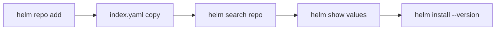

# Chart Repositories And Versions

Most charts you install were written by someone else and published in a chart repository. Before you can install one, you must tell Helm where the repository is, and you must choose the exact version to install. Without a version, Helm picks the newest stable one, and that can differ from what your team tested.

## Learning objectives

- Describe what a chart repository contains.
- Use `helm repo` and `helm search` to find a chart and its versions.
- Read values and metadata with `helm show` before installing.

## What a repository is

A chart repository is an HTTP server that serves two kinds of files: chart archives (files ending in `.tgz`) and one file named `index.yaml`. The index lists every chart in the repository, every version of each chart and the address of each archive. Helm downloads the index when you add or update the repository, and it keeps a local copy. Searching and installing read that local copy, which is why `helm repo update` matters.

These are the commands for managing repositories. The name and address are examples.

- `helm repo add NAME URL` registers a repository under a local name.
- `helm repo update` downloads the newest index for every repository.
- `helm repo list` shows the registered repositories.
- `helm repo remove NAME` deletes the registration.

A chart is addressed as `REPOSITORY/CHART`, for example `local-crew/crew-chart`.

## Searching and choosing a version

`helm search repo KEYWORD` searches the local copy of the indexes. It lists the newest version of each match. Add `--versions` to list every version, and `--version` with a constraint such as `'>=1.0.0 <2.0.0'` to filter. `helm search hub KEYWORD` searches a public directory over the internet instead.

Each row shows the chart version and the application version. The chart version is the version of the package, and it changes whenever the templates or defaults change. The application version, `appVersion` in `Chart.yaml`, is informational. It names the version of the software inside the package, and Helm does not use it to choose anything.

Inspect a chart before you install it.

- `helm show chart REPOSITORY/CHART` prints `Chart.yaml`.
- `helm show values REPOSITORY/CHART` prints the default values.
- `helm show readme REPOSITORY/CHART` prints the README.
- `helm show all REPOSITORY/CHART` prints all of the above.

Add `--version X` to any of them to inspect a specific version.

## Install a fixed version

`helm install RELEASE REPOSITORY/CHART --version X` installs that exact chart version. Without `--version`, Helm uses the newest version that is not a pre-release. Pre-release versions, such as `1.0.0-rc.1`, are only used when you pass `--devel` or ask for them in `--version`. The `--version` flag also accepts a range, and Helm then takes the highest version that fits.

Each step reads the local copy of the index, except the install, which also downloads the archive.

## OCI registries

Helm can also install from an OCI (Open Container Initiative) registry, the same kind of server that stores container images. There is no `helm repo add` step. The command uses a full address that starts with `oci://`, for example `helm install RELEASE oci://REGISTRY/PATH/CHART --version X`. The version is required to pick a tag.

## Common pitfalls

> [!WARNING]
> `helm search repo` reads the local index. A chart that was published a minute ago does not appear until you run `helm repo update`. Also, installing without `--version` can give a different result on different days, so always write the version in commands that others will repeat.
