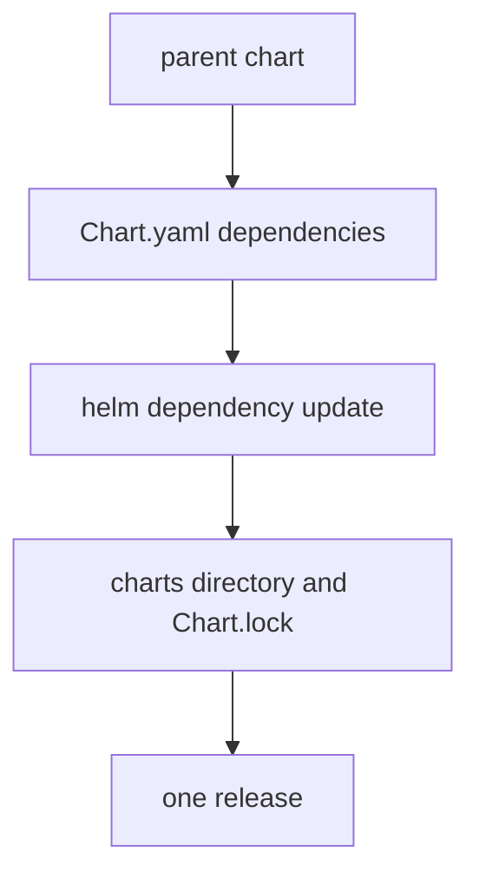

# Archives, Dependencies And Pulling Charts

A chart does not always come from a repository. You may receive an archive file, or you may need to read a chart's templates before you trust it. This part shows how to download and unpack a chart, how to package one, and how dependencies on other charts are handled.

## Learning objectives

- Pull a chart and unpack it to read its files.
- Package a chart directory into a versioned archive.
- Explain how `Chart.yaml` dependencies reach the `charts` directory.

## Pull and package

`helm pull REPOSITORY/CHART --version X` downloads the archive into the current directory. Adding `--untar` unpacks it into a directory named after the chart, and `--destination DIRECTORY` chooses where the file goes. Reading the unpacked `templates` directory is the most reliable way to learn what a chart will create.

`helm package DIRECTORY` does the reverse. It reads `Chart.yaml` in the directory and writes `NAME-VERSION.tgz`, where the name and version come from that file. The version in `Chart.yaml` is the only thing that decides the file name. Changing a template without changing the version produces a different archive with the same name, so change the version for every release of a chart.

An archive installs directly, without a repository.

```sh
helm install RELEASE ./NAME-VERSION.tgz
```

An unpacked chart directory also installs directly with `helm install RELEASE ./DIRECTORY`. `helm lint DIRECTORY` checks a chart for mistakes before you package it.

## Dependencies

A chart can depend on other charts. The dependencies are listed in the `dependencies` field of `Chart.yaml`, each with a `name`, a `version` range and a `repository` address. The command `helm dependency update DIRECTORY` downloads the matching archives into the `charts` directory inside the chart and writes a `Chart.lock` file that records the exact versions. `helm dependency build` rebuilds the `charts` directory from the lock file.

Helm installs a dependency, which it calls a subchart, as part of the same release. The parent chart can set a subchart's values by using the subchart name as a top-level key in its values. For example, a key named `database` with a nested `replicaCount` reaches the subchart named `database`. The same works on the command line with `--set database.replicaCount=2`. A dependency can also carry a `condition` field that names a boolean value. Setting that value to `false` leaves the subchart out of the release.



The parent and all subcharts render together into one set of objects under one release name.

## Common pitfalls

> [!WARNING]
> Installing a chart directory whose `charts` directory is missing or incomplete fails because the dependencies were not downloaded. Run `helm dependency update` first. Also, do not edit files inside an unpacked chart that you pulled and expect the repository version to change. The edit exists only in your copy.
